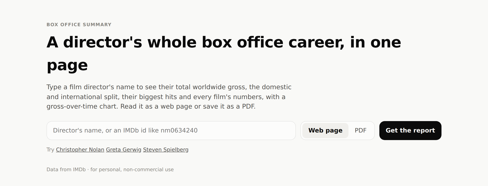
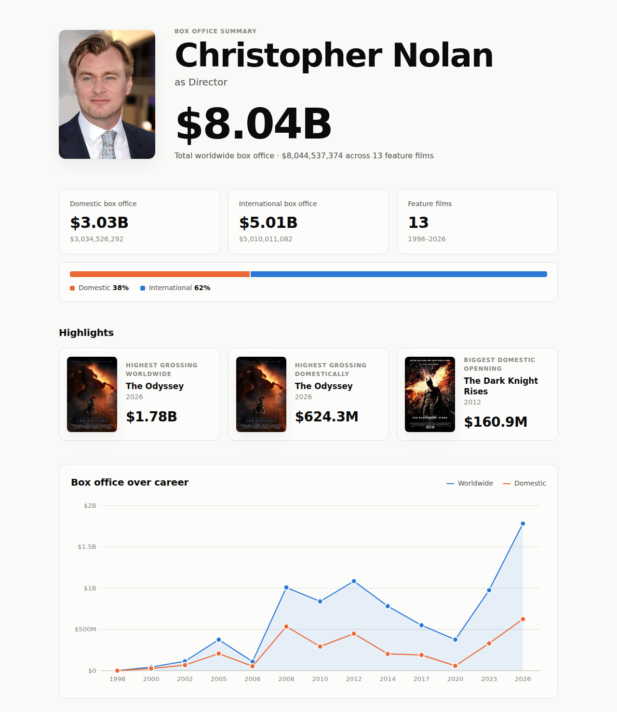
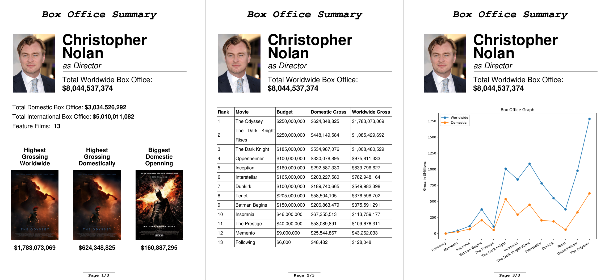
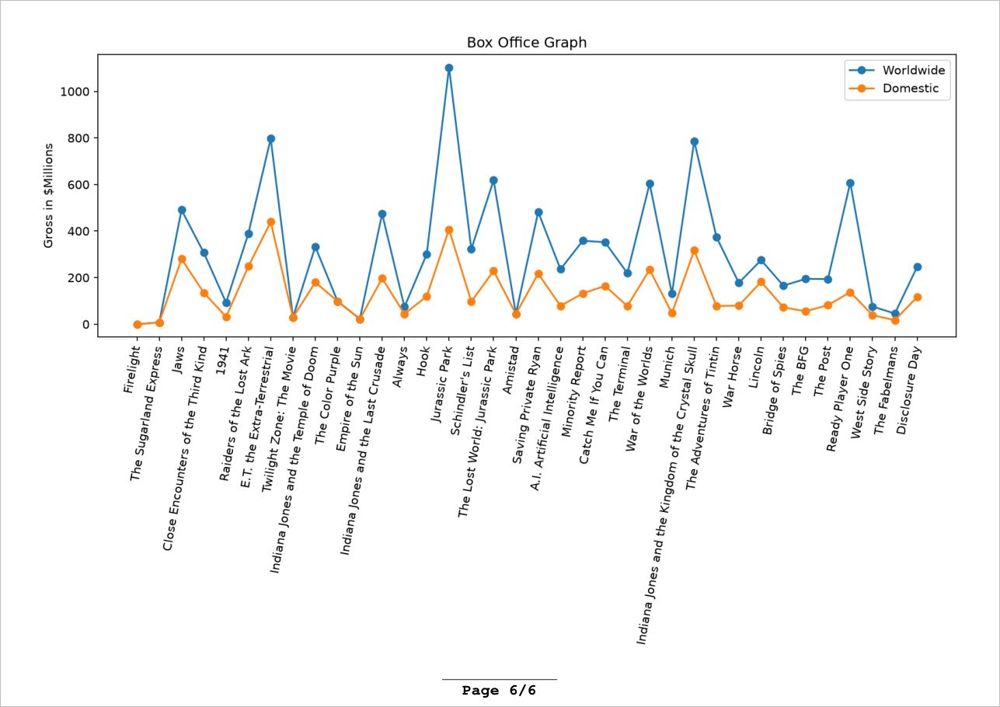

<div align="center">


# Director's Box Office Summary

**A director's whole box office career, in one page.**
Type a name to see their total worldwide gross, the domestic/international split, their biggest hits,
every film's numbers and a gross-over-time chart. Read it as a web page or save it as a PDF.
Data from IMDb, no API key needed.

<a href="https://directors-box-office-summary.vercel.app/"></a>


</div>

<picture>
  <source media="(prefers-color-scheme: dark)" srcset="docs/images/web-dark.png">
  
</picture>

<sub>The welcome page. Enter a name or an IMDb id, pick a format and press **Get the report**.</sub>

<picture>
  <source media="(prefers-color-scheme: dark)" srcset="docs/images/html-dark.png">
  
</picture>

<sub>Top half of the web report for Christopher Nolan. Full files:
[PDF](examples/christopher-nolan.pdf) · [HTML](examples/christopher-nolan.html)</sub>

The same report as a PDF: a summary page with the top films, the full filmography and the
career chart.



## Examples

| Director | Films | PDF | HTML |
|---|---:|---|---|
| Christopher Nolan | 13 | [christopher-nolan.pdf](examples/christopher-nolan.pdf) | [christopher-nolan.html](examples/christopher-nolan.html) |
| Greta Gerwig | 4 | [greta-gerwig.pdf](examples/greta-gerwig.pdf) | [greta-gerwig.html](examples/greta-gerwig.html) |
| Steven Spielberg | 36 | [steven-spielberg.pdf](examples/steven-spielberg.pdf) | [steven-spielberg.html](examples/steven-spielberg.html) |

GitHub previews the PDFs in the browser, but it shows HTML files as source code. To see the
page, download the file (**Raw**, then save) and open it in a browser. Images are embedded,
so it works offline.

These were generated on 2026-10-17. The numbers change as IMDb updates its data.

## Quick start

Requires Python 3.10 or newer.

```bash
git clone <repo-url>
cd DirectorsBoxOfficeSummary
python -m venv .venv
source .venv/bin/activate        # Windows: .venv\Scripts\activate
pip install -r requirements-dev.txt
uvicorn app:app --reload
```

Open <http://127.0.0.1:8000>. You don't need an account, key or `.env` file.

## Web app

- **Search:** type a name or an IMDb id (such as `nm0634240`, from the director's IMDb URL).
  Case and accents don't matter. A clear match opens the report straight away ("nolan" finds
  Christopher Nolan). If the name is ambiguous ("Paul Anderson"), you get a list of up to
  five people to choose from.
- **Format:** the **Web page / PDF** toggle picks how the report opens. Reports live at
  `/report/<nm id>.html` and `/report/<nm id>.pdf`, so you can link to them directly.
- **Errors** are shown on the search page, not as tracebacks. If IMDb or the network fails,
  the message says why (for example "IMDb returned 403").
- **Size and caching:** the web page links its images to IMDb's CDN rather than embedding
  them, so it is only tens of KB. Responses are cacheable for a day, so repeat requests
  don't hit IMDb.
- **Hosting:** it runs on Vercel's free Hobby plan (`app.py` and `vercel.json` are all it
  needs). Keep such a deployment private: see the disclaimer below.

## Command line

The CLI writes the same reports to files. Only the runtime dependencies are needed
(`pip install -r requirements.txt`).

```console
$ python main.py
Director's full name: Christopher Nolan
Found Christopher Nolan (nm0634240). Fetching filmography...
13 film(s).
Output format [pdf/html/both] (pdf): both
Building PDF...
Saved output/Christopher Nolan.pdf
Downloading 14 image(s)...
Saved output/Christopher Nolan.html
```

- **Name or id:** the same matching rules as the web app. An ambiguous name gives a numbered
  list; pick one, or leave it blank to cancel.
- **Format:** `pdf`, `html` or `both`. The first letter is enough, and a blank answer means
  `pdf`.
- **Output:** files go to `output/<Director Name>.pdf` and `.html`. The folder is created on
  first run. Unlike the web page, the CLI's HTML file embeds all images, so it works offline.

## What's in the report

Both formats contain:

- **Header:** portrait, name and total worldwide box office.
- **Totals:** domestic gross, international gross and the number of feature films.
- **Top three films**, with posters: highest worldwide gross, highest domestic gross and
  biggest domestic opening weekend.
- **Filmography:** every film ranked by worldwide gross, with its budget and grosses.
- **Career chart:** worldwide and domestic gross for each film, in release order.

### PDF

A4 pages with a fixed layout. The chart always gets the last page to itself. With more than
15 films that page switches to landscape, and the x-axis labels rotate or wrap so that every
title stays readable. Here is Spielberg's chart, with 36 films:



### HTML

All CSS and JavaScript are inlined (the CLI also inlines the images, giving a single offline file).

- **Light and dark themes:** follows your system setting.
- **Interactive chart:** hover a film, or focus it with the keyboard, to see its title, year
  and grosses.
- **Sortable table:** click a column header to sort. Films with missing data always sort
  last.
- **Extra table columns:** an opening weekend column, and a bar per film showing its
  worldwide gross with the domestic share highlighted.
- **Phone layout:** works on narrow screens. The chart and table scroll sideways.

### Which films count

The report includes **released feature films** that the person is credited as directing.
Shorts, TV movies, direct-to-video titles and unreleased or abandoned projects are left out.

All amounts are in US dollars. A missing figure is shown as `-`:

- A film with no box office data on IMDb stays in the table and is not left out.
- A budget that IMDb reports in another currency also shows as `-`. For example, RRR's
  budget is listed in Indian rupees.

## How it works

One run makes three requests to IMDb's GraphQL endpoint (`caching.graphql.imdb.com`): a
name search, the director's profile and their directing credits with box office data. For
the HTML page it also downloads the portrait and posters as small thumbnails. Dropped
connections, rate limits and server errors are retried with exponential backoff. If the API returns an error, the run stops
rather than producing a report with missing films.

```
main.py              prompts, file output; wires the layers together
app.py               the same pipeline as a web app (FastAPI)
src/
  movies.py          domain: API JSON -> Director / Movie, search ranking, totals, top films
  imdb_api.py        IMDb GraphQL queries
  http_client.py     HTTP with retries
  pdf.py, chart.py   PDF renderer (fpdf2) and matplotlib chart
  html_page.py       HTML renderer, with svg_chart.py and assets/ (CSS + JS)
  images.py          downloads the images for the HTML page as data URIs
  search_page.py     the web app's search page
tests/               offline tests for the HTML output and the web routes
examples/            the sample reports linked above
```

Everything under `src/` is free of side effects, and all I/O happens in `main.py` and `app.py`.

## Tests

```bash
pytest
```

The tests run offline and cover the HTML renderer (escaping, missing values, placeholders,
chart ordering, number formatting) and the web routes (redirects, candidate list, error
pages, PDF output). They need `requirements-dev.txt`.

## Disclaimer

This is a personal, non-commercial project and is not affiliated with IMDb. It uses IMDb's
unofficial, undocumented GraphQL API. Every response includes IMDb's notice that "public,
commercial, and/or non-private use" of the data is not allowed, and IMDb's Conditions of Use
prohibit automated access. The endpoint can change or be blocked without warning. Posters and
portraits belong to their respective owners.
